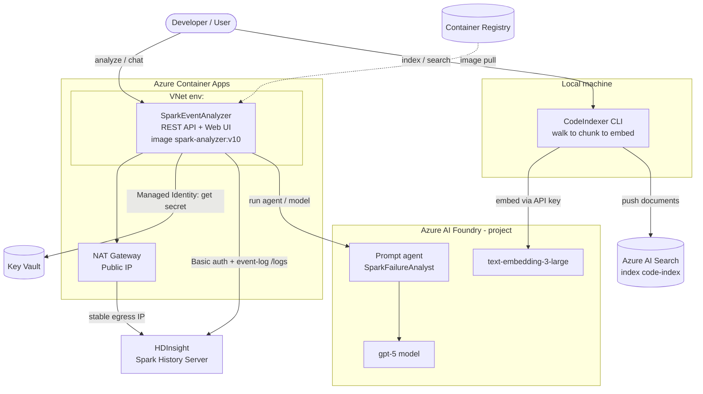
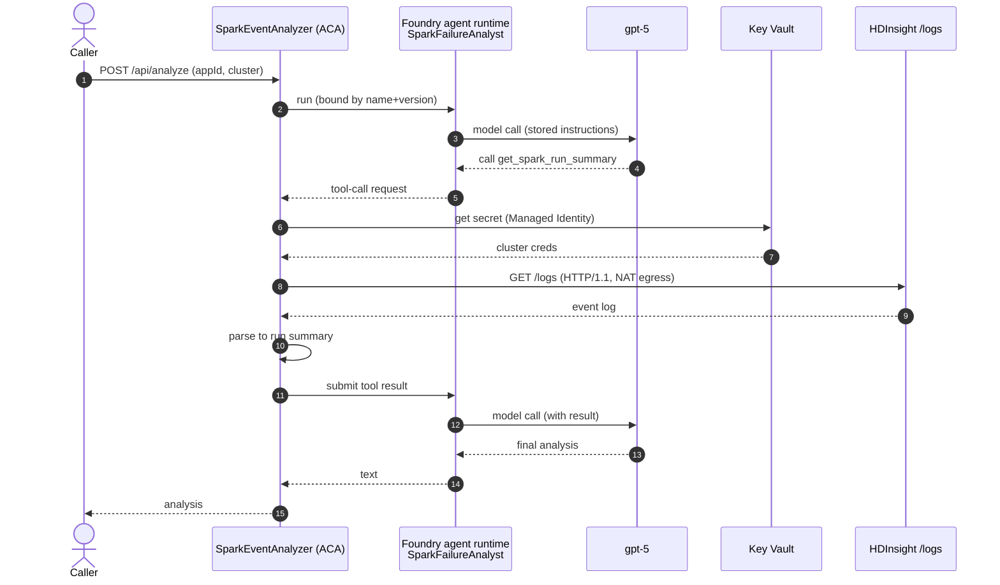
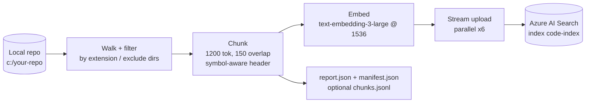

# Spark Event Analyzer + Code Indexer — Project Overview

This document describes the two tools in this repository:

1. **SparkEventAnalyzer** — an AI‑assisted service that analyzes Apache Spark application
   runs (HDInsight / Synapse / generic Spark History Server) for failures and performance
   issues, with a web UI, a REST API, and a swappable LLM agent backend (Azure AI Foundry).
2. **CodeIndexer** — a local CLI that embeds this repository's source code into an
   **Azure AI Search** vector index for semantic "search over the codebase".

Both run against Azure resources in resource group `<your-resource-group>`.

---

## 1. System architecture



**Key idea:** the SparkEventAnalyzer's LLM agent decides *when* to call the
`get_spark_run_summary` tool, but the tool always executes **inside the app** (it needs Managed
Identity for Key Vault and network egress to HDInsight). The Foundry project provides the model
(and, in prompt‑agent mode, a persisted/versioned agent definition + conversation state).

---

## 2. SparkEventAnalyzer

### 2.1 Purpose
Given a Spark application id, the service fetches a compact run summary (jobs, stages, executors,
failures, skew, spill, GC/memory pressure) and an LLM explains what happened and likely causes.
It supports three "tabs": **Analyze** (Spark run analysis), **Interact** (LLM with app data), and
**Chat** (general chat).

### 2.2 Project layout (`SparkEventAnalyzer/`)
| Area | Files |
| --- | --- |
| Entry point + endpoints | `Program.cs` |
| Web UI | `wwwroot/index.html` |
| Spark History REST client | `Services/SparkHistory/SparkHistoryClient.cs`, `ISparkHistoryClient.cs`, `SparkHistoryOptions.cs`, `SparkTarget.cs` |
| HDInsight credentials (Key Vault) | `Services/SparkHistory/HdInsightCredentialProvider.cs` |
| Run summarizers | `Services/Summarization/SparkRunSummarizer.cs`, `SparkEventLogSummarizer.cs` |
| Models | `Models/SparkModels.cs`, `SparkRunSummary.cs`, `SparkDateTimeOffsetConverter.cs` |
| Agent abstraction | `Services/Agents/IAnalystAgent.cs` |
| Agent providers | `Services/Agents/Providers/FoundryAnalystAgent.cs`, `PromptAgentAnalystAgent.cs`, `AzureOpenAIAnalystAgent.cs` |
| Agent tool | `Services/Agents/Tools/SparkTools.cs` |

### 2.3 REST API
| Method + path | Purpose |
| --- | --- |
| `GET /health` | Liveness. |
| `GET /api/spark/applications?platform&cluster` | List applications on the target. |
| `GET /api/spark/{appId}/summary?platform&cluster&attemptId` | Compact run summary (primary feature). |
| `GET /api/spark/{appId}/{jobs,stages,executors}` | Raw pass‑throughs (debugging). |
| `POST /api/analyze` | LLM analysis of a run (uses the summary tool). |
| `POST /api/chat` | General chat. |
| `POST/GET /api/ado/*` | Optional Azure DevOps MCP integration (disabled by default). |

For **HDInsight**, `attemptId` is required (bare app path returns 404), and only `platform` +
`cluster` (+ `appId`) are needed — the cluster password is fetched from Key Vault.

### 2.4 Spark History integration
- **Platform‑aware base URL + auth** (`SparkHistoryClient`): HDInsight uses Basic auth with
  cluster‑gateway credentials; Synapse uses an Entra bearer token; generic is a plain URL.
- **Event‑log path (primary for HDInsight):** downloads the History Server `/logs` zip **forcing
  HTTP/1.1** (the gateway hangs on HTTP/2 for this endpoint), unzips, and parses the raw event log
  (`SparkEventLogSummarizer`). Falls back to the jobs/stages/executors REST endpoints.
- **Tolerant date parsing** (`SparkDateTimeOffsetConverter`): Spark returns timestamps like
  `2026-09-18T06:09:22.113GMT`, which the default `DateTimeOffset` parser rejects; the converter
  handles the `GMT` suffix, ISO‑8601, and epoch millis.

### 2.5 HDInsight credentials via Key Vault
`HdInsightCredentialProvider` reads a Key Vault secret whose value is a **JSON map** of cluster
gateway FQDN to `"username:password"`, caches it, and returns the credentials for the requested
cluster. Managed Identity authenticates to Key Vault (the SDK acquires a token for
`https://vault.azure.net/.default` automatically).

- Vault: `<your-key-vault>`  •  Secret: `<secret-name>`
- Secret value (valid JSON):
  ```json
  {"my-cluster.azurehdinsight.net":"ambariuser:<password>"}
  ```
- Config: `SparkHistory:HDInsight:KeyVault:{VaultUri,SecretName}` (env
  `SparkHistory__HDInsight__KeyVault__VaultUri` / `__SecretName`).

### 2.6 Agent backends
Selected by `Agent:Provider` (env `Agent__Provider`). The `get_spark_run_summary` tool always runs
in‑process.

| Provider | What it is | Portal visibility | Where the loop runs |
| --- | --- | --- | --- |
| `Foundry` | Ephemeral, in‑process agent; Foundry is only the model host (Responses API). | Not shown | Your app |
| `PromptAgent` | Persisted, versioned Foundry **prompt agent** (`SparkFailureAnalyst`). | Shown (Agents / v2 API) | Your app (tool callbacks) + Foundry (definition + state) |
| `AzureOpenAI` | Direct Azure OpenAI chat. | n/a | Your app |

> Note: The prompt agent requires a **strict tool schema** (`additionalProperties:false`); the tool
> is built with `AIJsonSchemaTransformOptions { DisallowAdditionalProperties = true,
> RequireAllProperties = true }`.

### 2.7 Analyze request flow (prompt‑agent provider)



### 2.8 Deployment
- The service is packaged as a container image and pushed to a container registry.
- It runs on Azure Container Apps. A VNet‑injected environment is used for the HDInsight
  path so that outbound traffic leaves through a NAT Gateway with a **stable public IP** —
  HDInsight resolves and (optionally) allow‑lists that stable egress IP.
- A user‑assigned managed identity is granted **Key Vault Secrets User** (to read the
  HDInsight gateway credentials) and **AcrPull** (to pull the image); no secrets live in config.

---

## 3. CodeIndexer

### 3.1 Purpose
Embed the repository's source files into **Azure AI Search** so the codebase can be searched
semantically (and later used to ground an agent). Runs **locally** — it reads files off disk, so no
repo authentication is required.

### 3.2 Pipeline



- **Where work runs:** chunking + embedding orchestration run locally; the embedding *model* runs in
  Azure OpenAI; the **index build** (inverted index + HNSW graph + quantization) happens in the
  cloud Search service. Uploads are **streamed per batch** so the index fills progressively.

### 3.3 Project layout (`CodeIndexer/`)
| File | Responsibility |
| --- | --- |
| `Program.cs` | CLI (`init` / `index` / `search`), config, metrics, manifest. |
| `Chunking.cs` | File walk, language detection, token counting, symbol‑aware chunking. |
| `Embeddings.cs` | Azure OpenAI embeddings (dimension reduction, 429 retry). |
| `SearchStore.cs` | Index create/update, document upload, hybrid + semantic query. |
| `Models.cs` | Config, `CodeChunk`, `RunReport`, `Manifest`. |
| `appsettings.json` | Non‑secret config (endpoints, index name, chunk sizes). |

### 3.4 Index schema (`code-index`)
| Field | Type | Notes |
| --- | --- | --- |
| `id` | key string | `sha256(filePath#chunkIndex)` |
| `content` | searchable string | chunk text (BM25 for hybrid) |
| `contentVector` | Collection(Single), 1536 | HNSW cosine + **int8 scalar quantization** |
| `filePath`, `symbol` | searchable | citations |
| `repo`, `language` | filterable / facetable | |
| `startLine`, `endLine`, `chunkIndex` | Int32 | |
| `lastIndexed` | DateTimeOffset | |

Vector search: **HNSW** (m=4, efConstruction=400, efSearch=500, cosine) + **scalar quantization**;
queries use **hybrid** (keyword + vector) with a **semantic ranker** reranking pass.

### 3.5 Commands
```powershell
# secrets via env (never committed)
$env:CODEINDEXER_SEARCH_KEY = "<search admin key>"
$env:CODEINDEXER_AOAI_KEY   = "<azure openai key>"   # avoids az-CLI token timeouts on long runs

dotnet CodeIndexer.dll init
dotnet CodeIndexer.dll index --root C:\your-repo [--paths a,b] [--batch 48] [--parallel 6] [--dump] [--incremental]
dotnet CodeIndexer.dll search "how does the scheduler dispatch jobs" --k 8
```

### 3.6 Results (full‑repo run)
| Metric | Value |
| --- | --- |
| Files indexed | 1,410 |
| Chunks | 4,017 (avg 961 tokens, max 1,862) |
| Input tokens | 3,861,067 |
| Uploaded / failed | 4,017 / 0 |
| Est. embedding cost | ~$0.50 |
| Duration | ~9.5 min (6,786 tok/s) |
| By language | csharp 1,849 · powershell 1,104 · scala 668 · markdown 396 |

Local artifacts land in `.codeindex/`: `report.json` (metrics), `manifest.json` (incremental
state), and optionally `chunks.jsonl` (documents + vectors — the closest thing to a portable
"index file"; Azure AI Search itself is a managed service with no downloadable index blob).

---

## 4. Azure resources

The deployment uses the following Azure resources. Provision your own and supply the
values through configuration (`appsettings.local.json` / environment variables):

- **Azure Container Registry** — hosts the service's container image.
- **Azure Container Apps** — runs the service; a VNet‑injected environment is used for the
  HDInsight path so egress comes from a stable IP.
- **Virtual Network + NAT Gateway (with a public IP)** — provides a stable outbound IP for
  reaching HDInsight.
- **User‑assigned Managed Identity** — used for Key Vault and registry access (no secrets in config).
- **Azure Key Vault** — stores the HDInsight gateway credentials.
- **Azure AI Foundry (AI Services)** — hosts the chat model and the text‑embedding model.
- **Azure AI Search** — stores the code vector index used for semantic code search.

---

## 5. Authentication & security
- **Managed Identity** (`DefaultAzureCredential`) for Key Vault and Foundry from the deployed app;
  `az login` locally.
- **Key Vault token scope** `https://vault.azure.net/.default` is acquired automatically by the
  Key Vault SDK; **Foundry** uses the AI‑services scope; **HDInsight** uses Basic auth with the
  Key‑Vault‑sourced cluster credentials.
- **Secrets are never committed.** CodeIndexer reads the Search admin key and Azure OpenAI key from
  environment variables. Rotate any keys that were exposed in a terminal session.
- Windows gotcha: `az keyvault secret set --value` strips double quotes from JSON — use
  `--file <path>` to store JSON secrets.

---

## 6. Known limitations / future work
- **SparkEventAnalyzer**
  - The prompt agent (`kind: "prompt"`) is a newer Foundry object type; it is registered and
    runnable but may not appear in the classic portal *Agents* blade.
  - Synapse Spark History is browser‑only for completed jobs; server‑side JSON is limited to Livy
    batch + monitoring APIs.
- **CodeIndexer**
  - Incremental re‑index upserts by deterministic id; if a file shrinks, stale tail chunks can
    linger (delete‑by‑file not yet implemented).
  - The report's "skipped" count includes every non‑matching file the walker steps over (mostly
    wrong extension), so the number looks large — it is not a count of dropped source files.
- **Next step (optional):** expose CodeIndexer search as a `search_code` tool inside
  SparkEventAnalyzer's agent so the LLM can ground answers in the codebase.
```
